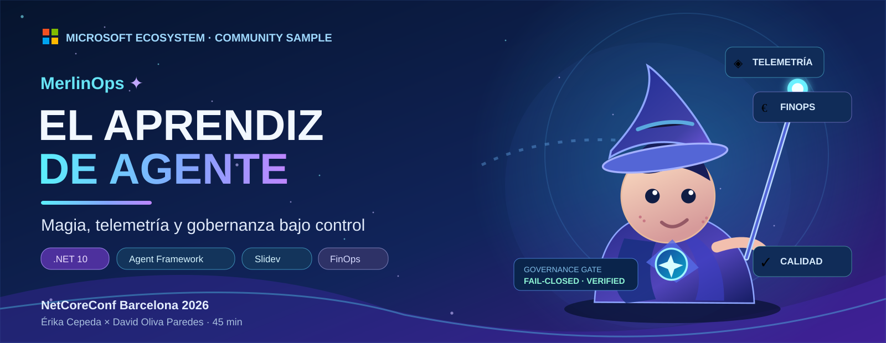
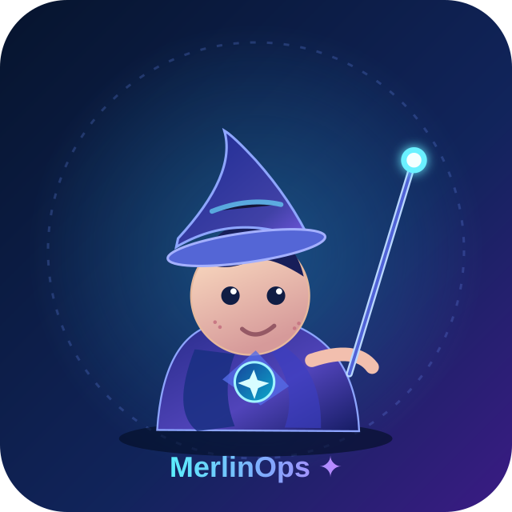
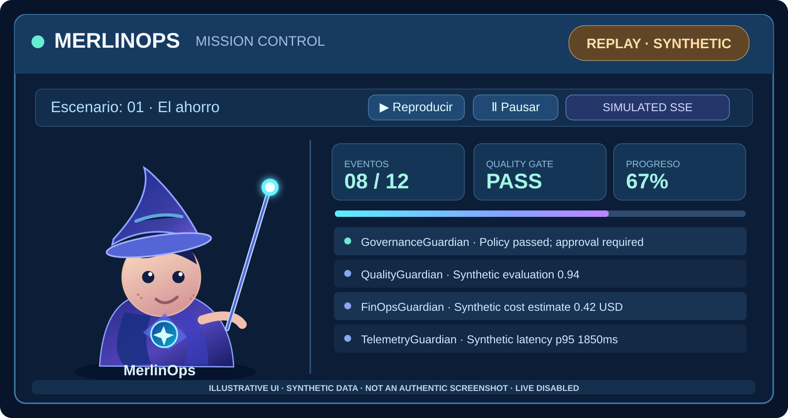
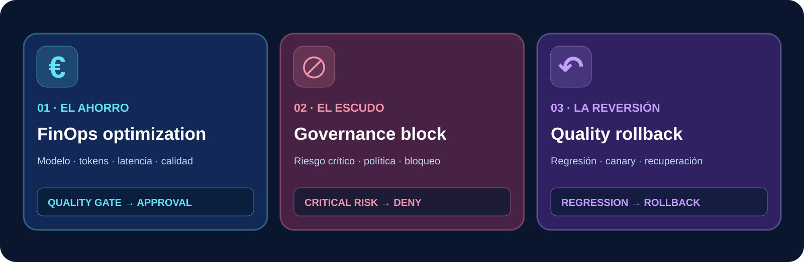
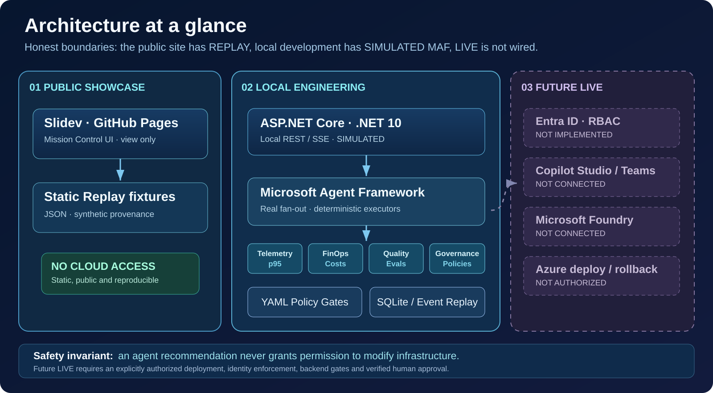

<strong>NETCORECONF BARCELONA 2026 · 45 MIN · ÉRIKA CEPEDA × DAVID OLIVA PAREDES</strong>

<a href="https://davidop.github.io/netcoreconf-barcelona-2026/"><strong>▶ ABRIR PRESENTACIÓN INTERACTIVA</strong></a> ·
<a href="docs/quickstart.md">⚡ Quickstart</a> ·
<a href="docs/diagrams/README.md">🧭 Arquitectura</a> ·
<a href="docs/scenarios.md">🧪 Escenarios</a> ·
<a href="docs/roadmap.md">🗺️ Roadmap</a>

---

## 🪄 What is MerlinOps?

**El aprendiz de agente** es una demo de ingeniería de agentes: **Érika** exige gobernanza y calidad; **David** impulsa automatización y FinOps. **MerlinOps** coordina cuatro Guardianes —Telemetría, FinOps, Calidad y Gobernanza— y demuestra que **una recomendación de IA no equivale a autorización para ejecutar cambios**.

La implementación actual ejecuta un **grafo real de Microsoft Agent Framework (MAF)**: delegación paralela a cuatro ejecutores deterministas locales y evaluación de Quality Gates mediante código. Los datos son **sintéticos** y las integraciones cloud están deshabilitadas.

> [!IMPORTANT]
> **Community sample — not an official Microsoft repository.** This project does **not** deploy to Azure, call Foundry models, integrate live with Copilot Studio, authorize real Teams approvals, or perform real rollbacks. Public demo data is explicitly **SIMULATED** or **REPLAY**. Azure creation and modification remain prohibited without separate explicit authorization.

### Technology at a glance

<table><tr>
<td align="center"> Microsoft ecosystem</td>
<td align="center"> .NET 10</td>
<td align="center"> Azure (future)</td>
<td align="center"> GitHub Actions</td>
<td align="center"> Slidev / Vue</td>
<td align="center"> Terraform (opt-in)</td>
</tr></table>

**Microsoft Agent Framework** · **Copilot Studio (roadmap)** · **Microsoft Foundry (roadmap)** · **OpenTelemetry (roadmap)**

## 🎯 Érika-first: MerlinOps improves its own incident workflow

**Priority for NetCoreConf:** connect **Copilot Studio + Microsoft Agent Framework (.NET 10) + Microsoft Foundry**; use a concrete synthetic Container Apps diagnostic *only as sample data*, optimize v1/v2 using comparable evidence, apply backend governance and demonstrate a verified **local** workflow rollback. No Container App creation is required. This is **supervised improvement inspired by self-learning**, not a claim of Microsoft's native self-learning feature.

The primary incident workflow now runs **real local MAF orchestration** with four Guardians and **9 local diagnostic calls in v1 vs 4 in v2** using the same **synthetic** incident evidence; its local execution duration is observed with Stopwatch (not real cloud latency). The earlier Container Apps comparator remains a secondary example with modeled durations. A critical policy or missing latency blocks approval; PASS means only **awaiting human review**.

[Ten final decisions and actual integration status](docs/ten-decisions-implementation.md) · [Three-product architecture](docs/demo-core-architecture.md) · [Run Érika's first slice](docs/erika-first-slice.md) · [Track Slidev orchestration](docs/live-orchestration.md) · [Optional read-only Azure evidence](docs/azure-readonly-evidence.md)

**No real Azure data has been read through this implementation yet.** The opt-in diagnostic script never uses Azure write operations; it does not claim p95 latency or actual per-app billing without authoritative data. Public Slidev remains a synthetic Replay demonstration.

## 🎬 See the experience

| MerlinOps | Mission Control |
|---|---|
|  |  |
| Original reusable wizard mascot | **UI illustration, not a captured screenshot.** [Open actual slide 6](https://davidop.github.io/netcoreconf-barcelona-2026/6). |

**Authentic screenshots:** download the test artifacts from the passing [Slidev Browser E2E workflow](https://github.com/davidop/netcoreconf-barcelona-2026/actions/workflows/e2e.yml). Illustrations are never presented as actual captures.

## 🧱 Architecture at a glance

**Current working slice:** local .NET 10 API → MAF workflow graph → four deterministic Guardians → fail-closed YAML policy → SQLite snapshot → SSE/Replay in Slidev.

**Public site:** GitHub Pages serves static Slidev and synthetic Replay fixtures; it does **not** access a privileged API.

**Future LIVE:** Entra authorization, verified human approval, Foundry/Copilot Studio/Teams connectors and Azure deployments. These are **not connected**. Explore [six architecture diagrams](docs/diagrams/README.md) and [security boundaries](docs/security.md).

## 🧑‍🚀 Three MerlinOps missions — same synthetic incident

**Conference protagonist:** MerlinOps improves **its own** incident-resolution workflow. The first local slice executes real MAF Guardian orchestration; cloud model reasoning and Copilot Studio delegation are **not yet wired**.

| Mission | Question from Érika | What the current local engine proves |
|---|---|---|
| **01 · Aprende** | Did v2 really improve the workflow without losing quality? | v1 makes 9 counted local tool calls; v2 makes 4 against the same incident fixture; measured local elapsed time and full evidence trace |
| **02 · El escudo** | What if the proposed retry budget exceeds policy? | Deterministic backend **DENY** before any human-approval or deployment events |
| **03 · La reversión** | Can we prove recovery after a late regression? | Synthetic quality regression; actual on-disk **local** workflow manifest restored to v1, SHA-256 verified |

**Source provenance:** fixture values are synthetic, and local duration is observed in .NET using a Stopwatch. Counts are local tool operations, **not Azure API calls**. Foundry tokens/cost are `null` until actual inference is verified. Technical PASS does not mean human approval.

[10 final scope decisions](docs/ten-decisions-implementation.md) · [Érika-first code and tests](docs/erika-first-slice.md)

## ⚡ Quickstart — no Azure subscription needed

**Prerequisites:** .NET 10 SDK, Node.js 22+, npm. No Azure credentials, Foundry API keys or Copilot Studio tenant are required for local execution.

~~~bash
git clone https://github.com/davidop/netcoreconf-barcelona-2026.git
cd netcoreconf-barcelona-2026

# Terminal 1 — .NET 10 local API
dotnet run --project src/MerlinOps.Api
~~~

~~~bash
# Terminal 2 — interactive slides
cd slides
npm install
npm run dev
~~~

Open **Mission Control (slide 6)** for synthetic Replay. Open **Érika's incident self-improvement scene (slide 7)** for the real local MAF v1/v2 comparison. The local API is required for executable tests; public Pages is read-only Replay.

~~~bash
curl -X POST http://localhost:5080/api/incident/compare \
  -H 'Content-Type: application/json' \
  -d '{"caseId":"incident-improvement"}'

dotnet test tests/MerlinOps.Tests/MerlinOps.Tests.csproj
~~~

[Detailed quickstart](docs/quickstart.md) · [Presenter runbook](docs/demo-runbook.md)

## 🔐 Provenance is a feature, not a footnote

| Mode | Source | Available | Claim |
|---|---|---|---|
| **REPLAY** | Synthetic, version-controlled JSON | ✅ Public web | Reproducible narrative; **not real Azure evidence** |
| **SIMULATED** | Local .NET/MAF workflow + SSE | ✅ Localhost | Real workflow mechanics; **fictional data and approval** |
| **LIVE** | Identity-protected Foundry, Copilot Studio and Azure | ❌ Not implemented or authorized | Future integration after separate approval and verification |

> [!CAUTION]
> A fictional approval never authorizes a deployment. Default policy denies cloud writes. GitHub Actions does **not** run Terraform apply.

## 📚 Documentation and navigation

| Resource | Use it for |
|---|---|
| [Getting started](docs/quickstart.md) | Prerequisites, commands and local checks |
| [Architecture](docs/architecture.md) and [six diagrams](docs/diagrams/README.md) | C4, modes, sequence, Guardian orchestration and trust boundaries |
| [Scenario playbook](docs/scenarios.md) | FinOps, critical-risk denial, and rollback |
| [Security](docs/security.md) | Threat boundaries, known gaps and governance |
| [Implementation status](docs/status.md) | Verified, simulated, scaffold and unverified features |
| [Design decision register](docs/decisions.md) | All **78 approved decisions** |
| [Presenter runbook](docs/demo-runbook.md) | Érika and David's 45-minute script |
| [Roadmap](docs/roadmap.md) | Backlog and graduation gates |
| [Media kit](docs/media-kit.md) and [brand guide](docs/brand-guidelines.md) | Original reusable visual assets and trademark conditions |
| [Agent engineering](docs/engineering.md) | GitHub Copilot, Claude Code and Codex specialization |
| [Contributing](CONTRIBUTING.md) · [Support](SUPPORT.md) | PR workflow and reporting channels |

## 🗂️ Repository map

~~~text
assets/                 Hero, social cards, wizard, illustrations and attributed logos
docs/diagrams/          C4 context, event sequence, execution modes and security
slides/                 Slidev, Mission Control and procedural MerlinOps 3D
src/MerlinOps.Api/      .NET 10 MAF simulation API, YAML policy, SQLite, SSE
src/MerlinOps.AppHost/  Local .NET Aspire orchestration
src/MerlinOps.AgentFrameworkAdapter/   SDK smoke test
tests/                  xUnit behavior and guardrail tests
policies/               Versioned fail-closed YAML rules
tools/                  Replay candidate sanitization with manual review
infra/                  Opt-in Terraform template, never automatically applied
skills/                 Engineering, governance and presenter UX agent skills
.github/workflows/      CI, E2E screenshot evidence, manual Pages publication
~~~

## 🤝 Community sample and contributions

This repository documents **78 approved decisions**, not 78 completed features. Follow the [roadmap](docs/roadmap.md) and [GitHub Issues](https://github.com/davidop/netcoreconf-barcelona-2026/issues); changes must preserve truthful labels, pass quality gates, and never create or modify Azure resources without separate user authorization.

The project is a community conference sample by **Érika Cepeda and David Oliva Paredes**, **not a Microsoft product or official Microsoft sample**.

**License:** [MIT for original code and original artwork](LICENSE). Third-party logos and trademarks remain subject to [their owners' conditions](assets/brand/README.md). [Social preview PNG](assets/banners/social-preview.png) · [Repository presentation setup](docs/repository-setup.md) · [Changelog](CHANGELOG.md) · [Contributing](CONTRIBUTING.md) · [Code of Conduct](CODE_OF_CONDUCT.md) · [Security reporting](SECURITY.md).

<strong>Magia sí. Observabilidad siempre. Cambios sin autorización, nunca. 🪄</strong>

