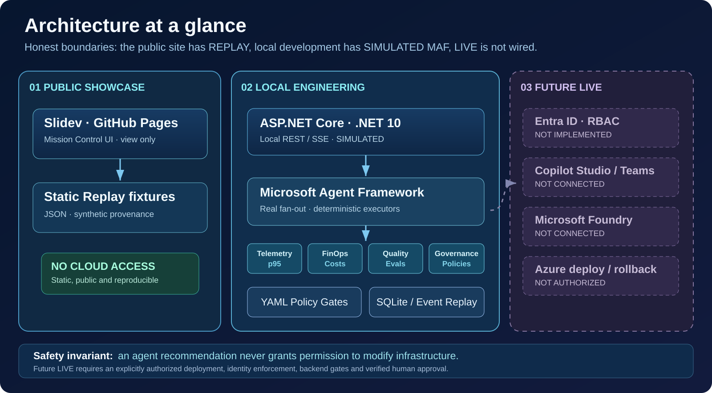
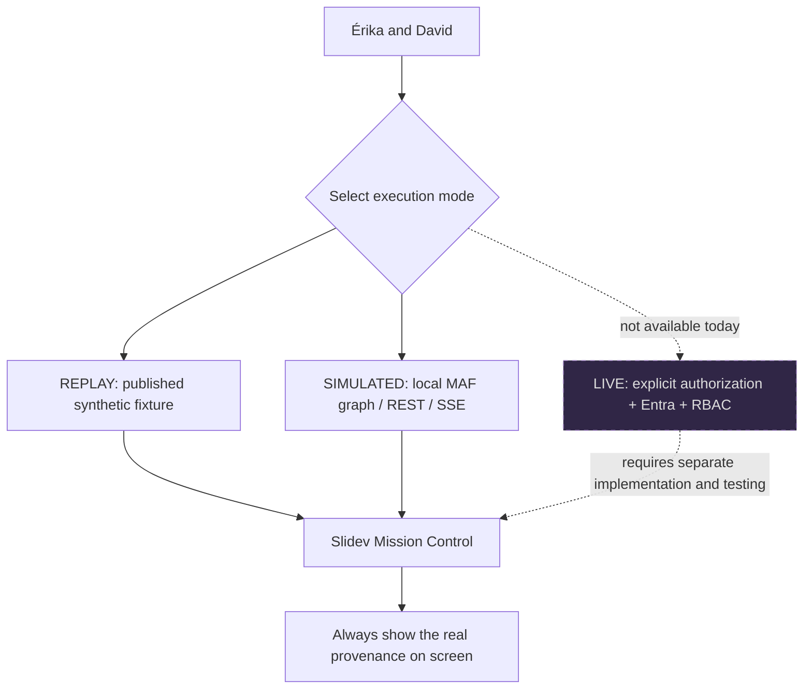

# Architectural diagrams

> Diagrams distinguish **implemented local behavior** from **future LIVE design**. Dashed connections are planned, not deployed.

## Featured architecture



## Mermaid sources

| View | Source | Explains |
| --- | --- | --- |
| Architecture overview | [architecture-overview.mmd](architecture-overview.mmd) | Public Replay, local .NET/MAF runtime, disabled cloud connectors |
| Execution modes | [execution-modes.mmd](execution-modes.mmd) | Accurate LIVE/REPLAY/SIMULATED provenance |
| Approval sequence | [quality-approval-sequence.mmd](quality-approval-sequence.mmd) | Four-Guardian MAF fan-out and deterministic policy |
| Trust boundaries | [trust-boundaries.mmd](trust-boundaries.mmd) | Public vs presenter vs future authenticated cloud |
| Three scenarios | [scenarios.mmd](scenarios.mmd) | Savings, policy-block, rollback |
| C4 context | [c4-context.mmd](c4-context.mmd) | Bounded context model (Mermaid C4 syntax) |

## Sequence (rendered)

```mermaid
sequenceDiagram
  autonumber
  participant Presenter as Presenters
  participant UI as Slidev Mission Control
  participant API as .NET API (local)
  participant MAF as MerlinOps (MAF)
  participant Guards as Four deterministic Guardians
  participant Policy as YAML policy gate
  participant DB as SQLite
  Presenter->>UI: Select scenario
  UI->>API: POST /api/runs/maf-simulate
  API->>MAF: Start local simulation
  par Four fan-out branches
    MAF->>Guards: Telemetry
  and
    MAF->>Guards: FinOps
  and
    MAF->>Guards: Quality
  and
    MAF->>Guards: Governance
  end
  Guards-->>MAF: Synthetic results
  MAF-->>API: Completed events
  API->>Policy: Evaluate deterministic rules
  alt Policy DENY
    Policy-->>API: Block
    API->>DB: Store blocked run
  else Policy PASS
    Policy-->>API: Requires human approval
    Note over API,DB: Current approval is simulated; not Teams authorization
    API->>DB: Store synthetic scenario
  end
  API-->>UI: Run ID / SSE event stream
  UI-->>Presenter: Provenance = SIMULATED

```

## Execution modes (rendered)



## Safety and accuracy

This example uses a real **Microsoft Agent Framework workflow graph** with deterministic executors, not live model-backed reasoning. Policy thresholds and synthetic approvals are local; they are not authorization to deploy. All Azure services in the future column require separate permission and implementation.
