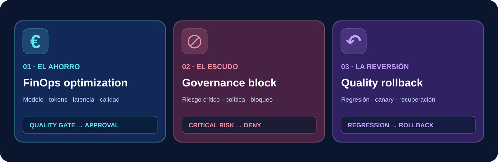

# Scenario playbook — three connected spells

[← Back to README](../README.md) · [Visual cards](../assets/scenarios/three-scenarios.svg) · [Runbook](demo-runbook.md)

## Cast and vocabulary

**MerlinOps**: supervisor, embodied by the animated wizard. **TelemetryGuardian**: latency and reliability observations. **FinOpsGuardian**: cost estimates. **QualityGuardian**: synthetic quality score. **GovernanceGuardian**: policy analysis; final authorization remains backend-enforced, not entrusted to a generative model.

**Érika** is the governance-and-quality mentor; **David** prioritizes optimization and automation. Keep a theatrical constructive disagreement, never let audience members trigger the demo.

## 01 — El ahorro

**Question:** can we choose a more cost-effective model without harming quality or latency?

**Local flow:** planner generates a deterministic plan → MAF fan-out calls four deterministic Guardians → YAML rules evaluate illustrative cost **USD 0.42**, quality **0.94**, p95 latency **1850 ms** → policy PASS → **fictional approval** → simulated canary → **synthetic projected relative reduction 24%**.

**Expected result:** COMPLETED with SIMULATED provenance. Do **not** claim real Foundry token metering, measured euro savings or deployment to Azure.

## 02 — El escudo

**Question:** what should happen when a proposal violates a critical rule?

**Local flow:** four Guardian completions → backend policy sees criticalRisk=true → DENY → run ends BLOCKED. The emitted event log contains **neither approval nor deployment** events.

**Expected result:** BLOCKED. This demonstrates fail-closed policy precedence over synthetic agent recommendations.

## 03 — La reversión

**Question:** how can safe automation recover from degradation?

**Local flow:** local deterministic policy PASS → **fictional approval and canary** → synthetic quality drops to **0.73** → synthetic rollback event → mission RECOVERED.

**Expected result:** ROLLED_BACK. Replay is synthetic; it is **not** a captured production rollback, real canary deployment or authorized Azure operation.

## Verification

~~~bash
dotnet test tests/MerlinOps.Tests/MerlinOps.Tests.csproj
curl -X POST http://localhost:5080/api/runs/maf-simulate \
  -H "Content-Type: application/json" \
  -d '{"scenario":"policy-block"}'
~~~

## Future LIVE transition (not implemented)

Requires proven Foundry measurements, runtime agent connectors, Entra ID token validation and RBAC, verified Teams approval, immutable audit records, budget alerts, failure recovery and explicit user authorization before any Azure modification. See [Roadmap](roadmap.md).
